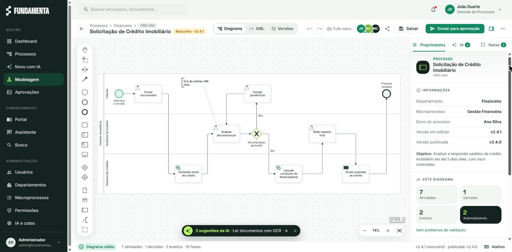
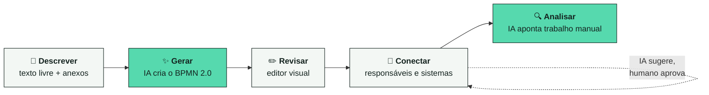
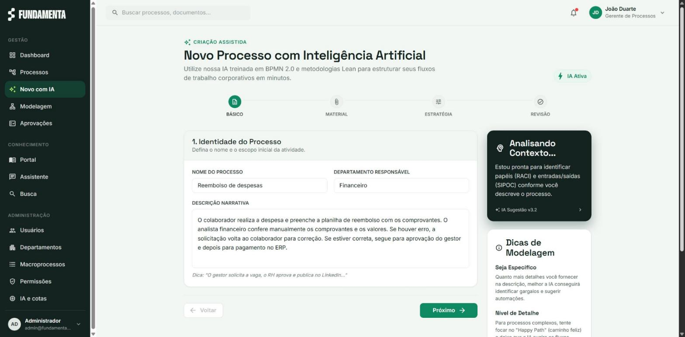

  

<picture>
  <source media="(prefers-color-scheme: dark)" srcset="docs/assets/brand/fundamenta-claro.svg" />
  
</picture>

  

**Sua organização, potencializada por IA.**

Gestão de processos (BPM) com IA · Bootcamp Software Engineering Project · MBA Faculdade Impacta

  
  

[Discovery](docs/produto/discovery.md) · [PRD](docs/produto/prd.md) · [AI Canvas](docs/produto/ai-canvas.md) · [MoSCoW](docs/produto/moscow.md) · [Histórias](docs/specs/historias-mvp.md)

---

O Fundamenta é uma plataforma de **gestão de processos (BPM) com inteligência artificial**. A pessoa descreve um processo em texto livre e a IA gera o fluxo em BPMN 2.0. Depois, a pessoa revisa o fluxo, liga cada atividade a um responsável e a um sistema, e a IA aponta onde está o trabalho manual e o que vale automatizar.

  
   
  Protótipo: editor de modelagem com o fluxo em BPMN, validação do diagrama e sugestões da IA

> Projeto do **Bootcamp · Software Engineering Project**, MBA em Engenharia de Software da Faculdade Impacta. Desenvolvido com o método **AI-DLC**: o agente escreve o código, e o POD especifica, revisa e responde por ele.

| | |
|---|---|
| **Status** | `checkpoint-02` · Produto: conteúdo concluído, aguardando PR e tag |
| **URL do MVP** | *a definir (checkpoint 05)* |
| **Protótipo (front-end)** | [sistema-fundamenta-front](https://github.com/limberjhonathan/sistema-fundamenta-front): Next.js 16, MUI e bpmn-js; beta visual com dados de exemplo |
| **Hipótese de valor** | [docs/produto/hipotese.md](docs/produto/hipotese.md) |

---

## POD

| Papel | Membro | Responde por |
|---|---|---|
| **Product Owner** | Limber Jhonathan | PRD, histórias e validação com usuários |
| **Tech Lead** | Vinicius Franco | Harness do agente ([AGENTS.md](AGENTS.md)) e arquitetura C1/C2 |
| **Quality & Ops** | Limber Jhonathan e Vinicius Franco | CI, testes, deploy e métricas |

Todos operam agentes e revisam PRs. O papel define quem responde por cada artefato.

---

## O problema

Nas empresas, os processos vivem espalhados em e-mails, mensagens, planilhas e documentos soltos, ou só na cabeça de quem executa. As três dores principais:

1. **Mapear depende de especialista.** Desenhar e manter um fluxo BPMN é lento e exige domínio da notação.
2. **Ninguém sabe quem faz o quê.** O processo não está ligado a responsáveis nem a sistemas, então as etapas se perdem e as tarefas são esquecidas.
3. **O trabalho manual fica invisível.** Achar retrabalho, gargalos e o que vale automatizar exige análise manual, que quase nunca acontece.

### O que o discovery mostrou

Conversamos com **5 profissionais** (gerente de projetos de TI e 4 funcionários de áreas operacionais) sobre processos reais: compras, reembolso, integração de novos colaboradores e suporte interno. Os detalhes estão em [discovery.md](docs/produto/discovery.md).

| Achado | Quem relatou |
|---|---|
| A falta de processo mapeado é uma dor real | **5 de 5** |
| Trabalho manual e retrabalho difíceis de enxergar | **4 de 5** |
| Responsável indefinido em cada etapa | E2, E4, E5 |
| Falta de visão geral do processo | E1, E4 |

> "Algumas tarefas acabam esquecidas ou atrasadas porque não existe uma visão geral do processo." (analista de recursos internos)

**Alternativas atuais:** Bizagi, Camunda Modeler, SAP Signavio, Visio, Lucidchart, Miro, Draw.io, planilhas e documentos. Elas são *poderosas, mas difíceis* (BPMN completo, feito para especialistas) ou *fáceis, mas sem inteligência* (desenham, mas não entendem o processo).

---

## A solução

O Fundamenta fica no espaço entre esses dois grupos: **fácil de criar** (basta descrever) e **inteligente depois** (a IA entende o processo e o contexto).

🟢 Etapas executadas pela IA · ⚪ etapas conduzidas pela pessoa, que sempre revisa o que a IA gera

| Etapa | O que acontece |
|---|---|
| **1. Descrever** | A pessoa conta como o processo funciona, em texto livre, e pode anexar materiais de apoio |
| **2. Gerar** | A IA cria o fluxo em BPMN 2.0, com início, atividades, decisões e fim |
| **3. Revisar** | O fluxo abre no editor visual para ajustes; o que foi gerado pela IA fica sinalizado até ser revisado |
| **4. Conectar** | Cada atividade recebe responsável e sistema; a IA sugere os vínculos e a pessoa aprova ou rejeita cada um |
| **5. Analisar** | A IA aponta atividades manuais e sugere automações, sempre com justificativa |

### O fluxo no protótipo

| 1 · Descrever | 2 · Revisar e conectar |
|---|---|
|  |  |
| A pessoa descreve o processo de reembolso em texto livre (caso real do discovery, E3) | O fluxo abre no editor, com raias por responsável, sistemas e atividades automatizáveis destacadas |

Beta visual com dados de exemplo; a integração com a IA entra no MVP.

### Por que a IA não é enfeite

Sem a IA, o Fundamenta vira mais um editor BPMN, que é justamente a alternativa que já existe. O valor depende da IA para **transformar texto não estruturado em processo estruturado** e para **analisar o processo com o contexto da organização** (pessoas, sistemas, atividades manuais). O humano sempre revisa o que a IA gera. Estratégia, dados, métricas e riscos estão no [AI Canvas](docs/produto/ai-canvas.md).

### Para quem

| Perfil | Necessidade |
|---|---|
| **Analista / gestor de processos** *(primeiro adepto)* | Ter um rascunho confiável do fluxo em minutos, em vez de desenhar do zero |
| **Profissional de RPA e automação** | Saber quais atividades são manuais e em quais sistemas acontecem |
| **Gestor de PME** | Documentar processos sem precisar aprender BPMN |

---

## Escopo do MVP

O MVP entrega **um fluxo completo, ponta a ponta**, e não uma fatia de cada módulo:

> **Descrever processo → IA gera BPMN → revisar e ajustar → vincular responsáveis e sistemas → IA aponta trabalho manual e automações**

| Prioridade | Itens |
|---|---|
| **Must** | Login com isolamento por organização · gerar BPMN com IA · editar e salvar · cadastrar pessoas e sistemas · vincular com sugestão da IA · análise de trabalho manual |
| **Should** | Busca por processo, atividade ou sistema · destaque de atividades sem responsável · exportar BPMN · selo "gerado por IA" · medir o tempo de documentação |
| **Fora do MVP** | Aprovações, portal, assistente (chat), dashboards, administração, acompanhamento da execução, riscos, KPIs e integrações |

O protótipo já mostra a visão completa do produto (14 telas). O MVP constrói só o que testa a hipótese central. Priorização completa em [moscow.md](docs/produto/moscow.md) e histórias em [historias-mvp.md](docs/specs/historias-mvp.md).

### Como saberemos que funciona

| Métrica | Meta inicial *(hipótese)* |
|---|---|
| Tempo para documentar um processo, comparado à ferramenta atual | ≤ 50% |
| Elementos do BPMN gerado mantidos pelo usuário | ≥ 70% |
| Taxa de acerto do eval da IA | ≥ 17 de 20 casos |
| Oportunidades de automação consideradas reais | ≥ 1 por processo |

---

## Artefatos de produto

| Artefato | Conteúdo |
|---|---|
| [Lean Canvas](docs/produto/lean-canvas.md) | Problema, segmentos, proposta de valor e modelo de negócio |
| [Hipótese de valor](docs/produto/hipotese.md) | "Acreditamos que..." e premissas de maior risco |
| [Discovery](docs/produto/discovery.md) | Proto-personas, concorrentes, 5 relatos de usuários e síntese |
| [AI Canvas](docs/produto/ai-canvas.md) | Por que IA, dados, métricas, plano de eval e riscos |
| [MoSCoW](docs/produto/moscow.md) | Priorização do MVP e ordem de corte |
| [PRD v1](docs/produto/prd.md) | Visão, público, requisitos, RNFs, critérios de aceite e métricas |
| [Histórias](docs/specs/historias-mvp.md) | US-01 a US-10, com 36 critérios Dado/Quando/Então |
| [Diário agêntico](docs/diario/) | O que o agente fez, onde errou e onde o POD interveio |

## Estrutura do repositório

| Caminho | Conteúdo |
|---|---|
| [`/AGENTS.md`](AGENTS.md) | Harness do agente: método, regras, limites e stack |
| [`/docs/produto/`](docs/produto/) | Artefatos de produto |
| [`/docs/specs/`](docs/specs/) | Histórias e critérios de aceite |
| [`/docs/adr/`](docs/adr/) | Decisões de arquitetura |
| [`/docs/diario/`](docs/diario/) | Diário agêntico, um arquivo por checkpoint |
| [`/docs/pitch/`](docs/pitch/) | Material do pitch e roteiro da demo |
| [`/architecture/`](architecture/) | Modelo LikeC4 (C1 e C2) |
| [`/prototype/`](prototype/) | Telas do protótipo |
| [`/evals/`](evals/) | Casos de avaliação da IA e script da taxa de acerto |
| [`/src/`](src/) | Código do MVP |
| [`/.github/`](.github/) | CI com testes e eval |

---

## Checkpoints

| # | Encontro | Entrega mínima | Status |
|---|---|---|---|
| 01 | Times e desafio | POD e papéis, Lean Canvas, hipótese, esqueleto do PRD, AGENTS.md v0 | ✅ Concluído |
| 02 | Produto | Evidências de discovery, AI Canvas, MoSCoW do MVP, histórias com critérios de aceite, PRD v1 | 🟢 Conteúdo pronto · PR e tag pendentes |
| 03 | Protótipo | Telas testadas com 2 ou mais usuários, ADR do design system, diário #1 | ⚪ |
| 04 | Design C1/C2 | C1 e C2 em LikeC4, ADRs, walking skeleton no ar com deploy e CI | ⚪ |
| 05 | MVP | URL pública, fluxo principal ponta a ponta, testes e eval no CI, rastreabilidade, diário #2 | ⚪ |
| 06 | Pitch | Pitch ao vivo com demo e material em `/docs/pitch/` | ⚪ |
